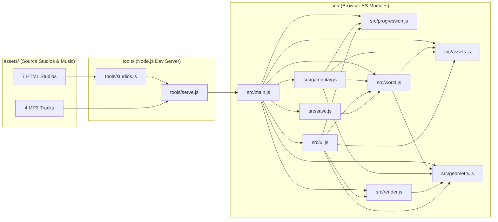

# Functions Map

Complete reference of modules, exports, internal functions, constants, and cross-module call flows across the Island Colony codebase.

---

## Architecture & Module Graph

---

## 1. `tools/studios.js` — Studio HTML-to-ES-Module Adapter

Reads the 7 standalone HTML studios in `assets/`, slices generator code at explicit marker comments, and returns ES module source strings plus extracted UI CSS.

| Symbol | Kind | Signature | Responsibility |
|---|---|---|---|
| `studios` | Constant (internal) | `Record<string, [file, boundary, exports]>` | Maps `island`, `character`, `building`, `collectible`, `resource`, `wildlife` to source HTML files, slice boundaries, and generated export blocks. |
| `section` | Function (internal) | `section(script, start, end)` | Extracts a substring between `start` and `end` markers; throws if either boundary is missing. |
| `readStudioModules` | Exported async function | `readStudioModules()` | Reads all 7 studio HTML files and returns `{ island, character, building, collectible, resource, wildlife, ui, uiCss }`. |

**Generated Virtual Modules Served Under `/studio/*.js`:**
- `/studio/island.js` — Exports `data`, `validation`, `terrainSvg`, `tiles`, `environmentSvg`, `canopySvg`, `effectSvg`, `effects`, `sourceFile`.
- `/studio/character.js` — Exports `createCharacter`, `generateRandomCharacter`, `renderCharacterSVG`, `animsFor`, `fps`, `metadata`, `DIRS`, `STG`, `A`, `sourceFile`.
- `/studio/building.js` — Exports `BD`, `statesOf`, `meta`, `sprite`, `sourceFile`.
- `/studio/collectible.js` — Exports `COLLECTIBLES`, `RARITY_DEFINITIONS`, `animsOf`, `renderCollectibleSVG`, `renderAnimationFrame`, `sourceFile`.
- `/studio/resource.js` — Exports `ITEMS`, `SRC`, `atlasJSON`, `renderResourceSVG`, `renderInventorySlot`, `sourceFile`.
- `/studio/wildlife.js` — Exports `WILDLIFE`, `HABITAT_TYPES`, `getAnimalMetadata`, `idleAnim`, `renderAnimalSVG`, `sourceFile`.
- `/studio/ui.js` — Exports `GameUI`, `UI_ICONS`, `UI_MARKERS`, `UI_THEME`, `UI_COMPONENTS`, `applyTheme`, `timeBox`, `frames`, `sourceFile`.
- `/studio/ui.css` — Raw gameplay CSS extracted from `<style id="gameui">` in `assets/ui-hud-studio.html`.

---

## 2. `tools/serve.js` — Zero-Dependency Development Server

Loads all studio modules into memory at startup and starts an HTTP server bound to `127.0.0.1` on `process.env.ISLAND_PORT || 8080`.

| Route / Behavior | Description |
|---|---|
| `GET /studio/ui.css` | Serves generated UI stylesheet from memory. |
| `GET /studio/<name>.js` | Serves generated ES module (`island`, `character`, `building`, `collectible`, `resource`, `wildlife`, `ui`) from memory. |
| `GET /` → `index.html`, `game.css`, `src/*.js` | Allowlisted static file serving with UTF-8 MIME headers. |
| `GET /assets/music/*.mp3` | Streams MP3 audio with HTTP `206 Partial Content` byte-range support (`Accept-Ranges: bytes`) and `416` validation. |

---

## 3. `src/assets.js` — Unified Asset Registry & Interaction Classifier

Normalizes all studio definitions into one indexed asset registry and maps island objects to playable job types.

| Symbol | Kind | Signature | Responsibility |
|---|---|---|---|
| `createAssets` | Exported function | `createAssets(studios)` | Builds and returns `{ registry, buildings, collectibles, resourceItems, resourceSources, animals, villager, terrain, ui, uiAssets, effects, canopySvg, validation, generateVillager, characterAnimations, characterFps }`. |
| `register` | Inner helper (`createAssets`) | `register(studio, definition, visual, aliases = [])` | Inserts an asset record with its `svg` generator and `sourceFile` into `registry` (and optional aliases), throwing on duplicate IDs. |
| `describeInteraction` | Exported function | `describeInteraction(object, assets)` | Classifies a map object, fishing spot, or crop into `{ type, resourceId, counter, ability, positions, waterTarget, sourceRequirements }` (`fish`, `farm`, `chop`, `mine`, `gather`, or `inspect`). |

**Key Registration Details:**
- Building states register under namespaced IDs `building:<assetId>` (plus bare `<assetId>` alias if unused) to prevent collisions such as `monument_restored`.
- Registers environment assets, terrain tiles, environment animations + deduplicated frames, 12 building types, 25 collectibles, 20 resource items + state variants, 10 wildlife species, the `villager` composite generator, the `island` terrain map, and UI icons/markers/frames.

---

## 4. `src/geometry.js` — Coordinates, Grid Walkability & Pathfinding

Pure math and grid utilities shared across world simulation, gameplay, rendering, and input.

| Symbol | Kind | Signature | Responsibility |
|---|---|---|---|
| `tileToWorld` | Exported function | `tileToWorld({ x, y }, size)` | Converts a tile coordinate to its world-space center pixel `{ x, y }`. |
| `worldToTile` | Exported function | `worldToTile({ x, y }, size)` | Converts a world-space pixel `{ x, y }` to integer tile coordinates via `Math.floor`. |
| `screenToWorld` | Exported function | `screenToWorld({ x, y }, camera)` | Maps canvas screen coordinates to world coordinates using `camera.{ x, y, zoom }`. |
| `worldToScreen` | Exported function | `worldToScreen({ x, y }, camera)` | Maps world coordinates to canvas screen coordinates. |
| `neighbors` | Exported constant | `Array<{ x, y, facing }>` | 4-directional cardinal offsets (`right`, `left`, `front`, `back`). |
| `walkable` | Exported function | `walkable(grid, { x, y })` | Returns `true` when `(x, y)` are integers and `grid[y][x] === 0`. |
| `sameTile` | Exported function | `sameTile(a, b)` | Returns `true` if `a.x === b.x && a.y === b.y`. |
| `findRoute` | Exported function | `findRoute(grid, start, destinations)` | 4-way Breadth-First Search from `start` to the nearest walkable tile in `destinations`; returns `{ path, target }` or `null`. |
| `zoomAt` | Exported function | `zoomAt(camera, screen, zoom)` | Mutates `camera` to `zoom` while keeping the world point under `screen` fixed. |

---

## 5. `src/progression.js` — Research, Construction & Landmark Rules

Declarative balance tables and cost formatting used by gameplay and UI.

| Symbol | Kind | Type / Signature | Responsibility |
|---|---|---|---|
| `researchProjects` | Exported constant | `Record<abilityId, { cost, flag?, hint }>` | Defines Knowledge costs, prerequisite world flags, and hints for `farm`, `fish`, `heal`, `advanced_construction`, and `ancient_knowledge`. |
| `construction` | Exported constant | `Record<buildingType, { wood, stone }>` | Material costs for the 5 constructible buildings: `house`, `family_house`, `food_storage`, `research_hut`, `healing_hut`. |
| `landmarks` | Exported constant | `Record<puzzleId, { label, hint, cost?, flags?, ability?, state, art?, job }>` | Defines all 7 island landmark projects from `light_campfire` through `restore_monument`. |
| `costLabel` | Exported function | `costLabel(cost = {})` | Formats a cost object into a readable label (e.g., `"10 Wood · 4 Stone"`). |

---

## 6. `src/world.js` — Serializable World State, Movement & Placement

Creates and advances the versioned world state, manages resource counters, validates wildlife habitats, and checks building placement footprints.

| Symbol | Kind | Signature | Responsibility |
|---|---|---|---|
| `abilities` | Exported constant | `Array<{ id, name, animation, startsUnlocked }>` | Master list of 11 abilities (5 unlocked at start, 5 researchable, plus `hunt` placeholder). |
| `skillDefinitions` | Exported constant | `Array<{ id, name, abilityId }>` | Abilities that map to villager animations and trackable skill XP. |
| `createResourceManager` | Exported function | `createResourceManager(amounts, limits = {})` | Returns `{ get, add, remove, canAfford, subscribe }` over shared resource counters, notifying subscribers only on actual value changes. |
| `habitatMatches` | Exported function | `habitatMatches(map, animal, tile, habitat)` | Checks whether a tile matches an animal's terrain, region, water body, and ground-walkability constraints. |
| `habitatAllows` | Exported function | `habitatAllows(map, animal, tile)` | Checks `habitatMatches` across an animal's entire `collisionFootprint`. |
| `createWildlife` | Internal function | `createWildlife(map, animals)` | Computes habitat tile sets and deterministically places 1 instance of each of the 10 wildlife species spaced around the spawn area. |
| `previewCollectibles` | Internal function | `previewCollectibles(map, collectibles)` | Generates 4 developer-preview collectible markers (one each for `seashell`, `mineral`, `artifact`, `butterfly`). |
| `createWorld` | Exported function | `createWorld(assets)` | Initializes the full `version: 1` state (5 starting villagers: Luna, Kai, Mira, Tavi, Oren; 28 Food; 250 map objects; 10 wildlife; 25 collection entries; clock at Day 1 08:00; clear weather) plus runtime helpers (`resources`, `collision`, `habitatTiles`, `objects`, `collectiblePreviews`). |
| `moveVillager` | Exported function | `moveVillager(world, villager, destinations, targetId = null)` | Computes a BFS route via `findRoute`, updates `villager.route` and `currentTask`, and finishes immediately if already at destination. |
| `approachObject` | Exported function | `approachObject(world, villager, object)` | Resolves interaction points via `describeInteraction` and calls `moveVillager`. |
| `finishMove` | Internal function | `finishMove(villager)` | Applies target facing direction, clears `currentTask`, and sets animation to `idle`. |
| `advanceEntity` | Internal function | `advanceEntity(entity, distance, size, onDirection)` | Advances an entity smoothly along tile centers in `entity.route` at a given pixel step distance. |
| `updateWildlife` | Internal function | `updateWildlife(world, time)` | Periodically chooses adjacent valid habitat tiles for each animal, sets movement/rest animations (`fly`, `swim`, `hop`, `walk`, `slither`, `crawl`, `rest`), and moves them at `12 px/s`. |
| `updateWorld` | Exported function | `updateWorld(world, delta)` | Advances island clock (`5 in-game min/s`), moves walking villagers (`44 px/s`), delegates to `world.gameplay.advance(elapsed)`, and updates wildlife. Skips if paused or `delta <= 0`. |
| `previewPlacement` | Exported function | `previewPlacement(world, definition, origin)` | Evaluates whether a building footprint at `origin` is inside an allowed zone, free of existing buildings, meets terrain or `requiredWaterTiles` rules, and returns `{ asset, origin, tiles, allowed }`. |

---

## 7. `src/gameplay.js` — Simulation Rules, Jobs, AI, Families & Landmarks

Implements the core simulation controller attached to `world.gameplay`.

### Exported Factory & Returned API

| Symbol | Kind | Signature | Responsibility |
|---|---|---|---|
| `startGameplay` | Exported function | `startGameplay(world)` | Initializes simulation timers, rebuilds collision, attaches `world.gameplay`, and returns the gameplay controller object. |
| `gameplay.advance` | API method | `advance(elapsed)` | Runs periodic needs/eating, illness, birthdays/aging/death, weather cycling, collectible spawning, resource regrowth, and per-villager AI/work ticks. |
| `gameplay.assign` | API method | `assign(villager, ref)` | Validates target and villager eligibility, routes villager to interaction point, sets `work` and `preferredJob`, clears `heldObject`. Returns error string or `null`. |
| `gameplay.move` | API method | `move(villager, tile)` | Routes villager to a walkable tile and stops any current/preferred job. Returns error string or `null`. |
| `gameplay.drop` | API method | `drop(villager, tile, ref)` | Teleports a dragged villager immediately onto reachable ground, a delivery point (completing delivery if carrying supplies), or an interaction point (starting work immediately). Returns error string or `null`. |
| `gameplay.place` | API method | `place(type, tile)` | Validates cost, footprint, villager clearance, and entrance reachability; deducts materials, creates a `foundation` building, refreshes collision, and announces placement. |
| `gameplay.research` | API method | `research(id)` | Checks unlock state, prerequisite world flag, and Knowledge cost; unlocks village ability and announces it. |
| `gameplay.stop` | API method | `stop(villager)` | Cancels active route, work, and `preferredJob`, and delays autonomous chore selection for 12s. |
| `gameplay.refreshCollision` | API method | `refreshCollision()` | Rebuilds `world.collision` from base map collision + unlocked bridge/cave/waterfall tiles + placed building collision footprints, and invalidates collectible reachability cache. |
| `gameplay.revision` | API getter | `get revision()` | Monotonic counter incremented on every announcement; used by UI to trigger panel refreshes. |
| `gameplay.subscribe` | API method | `subscribe(listener)` | Registers a callback invoked with announcement messages. |

### Internal Helpers in `startGameplay`

| Function | Responsibility |
|---|---|
| `announce(message)` | Increments `revision` and broadcasts status notifications to listeners. |
| `pay(cost)` | Atomically checks `resources.canAfford(cost)` and deducts each resource. |
| `buildingAsset(building)` | Looks up `building:<type>_<state>` in `assets.registry`. |
| `buildingPoints(building)` | Translates relative building interaction points into map tile coordinates. |
| `completeBuilding(type)` | Finds the first completed village building matching `type`. |
| `puzzleBlocked(puzzle)` | Returns `true` if a landmark lacks required ability, world flags, or resources. |
| `memberPoints(target)` | Returns walkable 4-way adjacent tiles facing a target villager. |
| `familyIssue(a, b)` | Enforces Family House, adult life stage, partner compatibility, population capacity, newborn-care cooldown, and 12 Food requirement. |
| `plan(target, villager)` | Resolves what job, interaction points, counter, animation, or error applies when assigning `villager` to `target` (`villager`, `collectible`, `building`, landmark, `crop`, or map object). |
| `mapFacingTile(tile)` | Returns `[tile, ...adjacentTiles]` as interaction candidates for collectibles. |
| `getTarget(ref)` | Resolves `{ kind, id }` from buildings, villagers, active collectibles, crops, or static map objects/fishing spots. |
| `assignmentIssue(villager, action)` | Enforces age restrictions (babies cannot work; children can only `gather`, `collect`, `fish`), newborn-care busy state, and health `< 30` guard. |
| `setAssignment(villager, target, ref, action, remember)` | Sets `villager.work` and stores repeating `preferredJob` for reusable jobs (`gather`, `chop`, `mine`, `research`, `farm`, `fish`). |
| `land(villager, tile)` | Immediately places a villager on `tile`, clears route/work, sets facing, and applies a 2s retry delay. |
| `applyPuzzle(target, villager)` | Pays landmark cost, sets `worldFlags[puzzleId]`, updates object art/state, spawns 8 crops on `unblock_spring`, awards `island_restored` on `restore_monument`, refreshes collision, and announces completion. |
| `build(target)` | Advances building `progress` through `foundation → p25 → p50 → p75 → completed`; raises `populationCapacity` (`+3` House, `+2` Family House) on completion. |
| `haveChild(villager, target)` | Deducts 12 Food, generates a baby villager at the Family House, links partner/parent/child relationships, sets 30s newborn care cooldown, and announces birth. |
| `collect(target)` | Removes active collectible from map, increments `discoveryCount`, marks first discovery day, and announces new finds. |
| `deliveryPoints()` | Returns campfire interaction points plus completed Food Storage points (if built). |
| `finishWork(villager, target)` | Awards +1 skill XP, subtracts 6 energy, and resolves job outcomes (landmark, construction step, Knowledge gain, healing, child birth, collection, crop growth stage, or starting `deliver` phase). |
| `deliver(villager)` | Computes carry quantity (`2 + floor(skill/4)` capped at 5; or `7` for stage-3 crops), depletes map object amounts/states, schedules 35s regrowth for renewable sources, and adds to resource counters. |
| `resumeJob(villager)` | Re-assigns a villager to their `preferredJob`, automatically seeking the nearest non-empty source of the same counter/job if depleted. |
| `beginWork(villager)` | Enters `work` phase with skill-scaled duration `max(1, 3.2 - skill * 0.12)` seconds and sets activity label/animation. |
| `chooseChore(villager)` | Autonomous priority AI: heal sick (`<65` health) → gather/farm/fish when food is low → build unfinished foundations → chop wood (`<35`) → mine stone (`<25`) → research (`<35` Knowledge). |
| `advanceVillager(villager, elapsed)` | Per-tick state machine for walking, delivering, working, newborn care (`holdBaby`), resting (`energy < 45`), sick idle (`health < 55`), resuming preferred jobs, autonomous chores, and seeded leisure wandering. |
| `availableCollectibleTiles()` | Flood-fills reachable tiles from villager spawn 0 and caches reachable tiles per collectible zone (plus `garden_zone_001` once restored). |
| `spawnCollectible()` | Spawns up to 5 live collectibles filtered by day/night, weather, research level, unlocked landmarks, and reachable zones, prioritizing undiscovered items. |

---

## 8. `src/render.js` — Canvas 2D Layered Renderer & Pixel-Accurate Picking

Draws the terrain, Y-sorted sprites, tree canopies, animated water effects, placement ghosts, HUD world markers, and 14 debug overlays; provides alpha-tested hit picking.

| Symbol | Kind | Signature | Responsibility |
|---|---|---|---|
| `svgUrl` | Exported function | `svgUrl(svg)` | Encodes an SVG string into an inline `data:image/svg+xml;charset=utf-8,...` URL. |
| `debugOptions` | Exported constant | `Record<overlayKey, label>` | 14 toggleable debug overlay modes (`grid`, `coords`, `walk`, `collision`, `build`, `farm`, `fishing`, `targets`, `ids`, `interactions`, `anchors`, `depth`, `habitats`, `collectibles`). |
| `frameAt` | Internal function | `frameAt(animation, seconds)` | Computes current animation frame index honoring `fps`, `frameCount`, and `loop === false`. |
| `createRenderer` | Exported function | `createRenderer(canvas, world, camera, view)` | Initializes sprite caches, offscreen hit-mask and debug overlay canvases, and returns `{ render, pick }`. |
| `renderer.render` | API method | `render()` | Renders the complete frame: DPR resize → ocean fill → terrain layer → ground decorations → Y-sorted entities (objects, crops, buildings, villagers, wildlife, collectibles) → canopies → water/waterfall effects → fishing indicators → placement ghost → debug overlays → selection/destination/interactable/dragged-villager markers. |
| `renderer.pick` | API method | `pick(position, only, excludeId)` | Pixel-accurate top-down hit test against rendered sprites (`villager` → `building` → `crop` → `collectible` → `object`), falling back to tile checks for crops and fishing spots. |

### Internal Helpers in `createRenderer`

| Function | Responsibility |
|---|---|
| `image(key, makeSvg)` | Lazily decodes and caches SVG `Image` objects (using `Blob` URLs for SVGs > 40 KB, data URLs otherwise). |
| `drawImage(image, x, y)` | Draws a loaded image at rounded pixel coordinates without smoothing. |
| `describeSprite(entity, asset, options, position, hit)` | Computes anchor-adjusted top-left `(x, y)` and depth `position.y`. |
| `paintSprite(sprite)` | Performs viewport frustum culling, draws cached SVG frame, and records clickable hit-box metadata. |
| `objects()` / `villagers()` / `buildings()` / `creatures()` / `collectibles()` / `crops()` | Build sprite descriptor arrays for each entity category. |
| `drawEffects()` | Draws animated `water_ripple`, `shore_waves`, and `waterfall_flow` (hidden once `open_waterfall_passage` is set). |
| `drawMarker(position, color, radius)` | Draws framed square debug markers. |
| `drawStudioMarker(id, position)` | Draws UI studio world markers (`marker_selection_ring`, `marker_destination`, `marker_interactable`, `marker_picked_up`). |
| `drawPreview()` | Draws green/red footprint tiles and semi-transparent ghost sprite during building placement. |
| `drawDebug(sprites)` | Renders cached tile-layer overlays (`overlay` canvas) plus live anchor, depth, and object-ID annotations. |
| `hasPixel(sprite, position)` | Caches alpha channel bitmap in a `WeakMap` and tests whether the clicked pixel has non-zero alpha. |

---

## 9. `src/ui.js` — HUD Adapter, Panels, Audio & Debug Controls

Connects `GameUI` studio components to live world state, handles panel navigation, adaptive background music, and debug inspection.

### Exported Symbols & Returned API

| Symbol | Kind | Signature | Responsibility |
|---|---|---|---|
| `musicTrack` | Exported function | `musicTrack({ time, weather })` | Selects `'menu'` (paused), `'rain'` (rainy), `'daytime'` (06:00–19:00), or `'nighttime'` (19:00–06:00). |
| `createUI` | Exported function | `createUI(world, view, actions)` | Applies HUD theme, renders HUD chrome, subscribes to resource counters, wires DOM events and audio, and returns `{ inspect, notify, selectVillager, refreshStatus, refreshProfile, closeMenu, togglePause }`. |
| `ui.inspect` | API method | `inspect(position, hit)` | Populates the Debug JSON inspector with entity, tile, terrain, walkability, interaction, puzzle, and locked-region data. |
| `ui.notify` | API method | `notify(text)` | Appends to notification log, displays a 3.6s HUD toast, and refreshes the Notifications panel if open. |
| `ui.selectVillager` | API method | `selectVillager(villager)` | Opens Villagers panel, updates bottom selection card, refreshes debug inspector, status, and profile. |
| `ui.refreshStatus` | API method | `refreshStatus()` | Diffs and updates clock/weather box, speed buttons, pause banner, population counter, focus button state, and open panels on gameplay revisions. |
| `ui.refreshProfile` | API method | `refreshProfile()` | Live-updates selected villager's activity text, age, health/hunger/energy percentages, and skill XP list. |
| `ui.closeMenu` | API method | `closeMenu()` | Closes the active menu panel, clears history, restores title screen if opened from title, and returns focus to trigger element. |
| `ui.togglePause` | API method | `togglePause()` | Toggles simulation pause state and opens/closes the Pause menu. |

### Internal Helpers in `createUI`

| Function | Responsibility |
|---|---|
| `element(id)` / `escape(value)` / `img(svg, css)` | DOM lookup, HTML entity escaping, and inline SVG `` formatting. |
| `clampMusicVolume(volume)` / `readAudioSettings()` / `saveAudioSettings()` | Clamps volume (`1–100`) and persists it under `localStorage['island-colony.audio']`. |
| `refreshMusicControls()` / `setVolume(volume)` / `syncMusic(fromGesture)` / `startMusic(event)` | Syncs audio slider, handles browser autoplay policies, switches MP3 track on clock/weather/pause changes, and retries on first user click/key gesture. |
| `hudState()` / `portrait(villager, css)` | Formats world state for `GameUI` renderers and generates villager portrait markup. |
| `renderVillagers()` | Renders selected villager profile (age, task, needs, skills, children, Stop Work) and full villager roster buttons. |
| `renderBuildings()` | Renders 12-building gallery with state selector, footprint, purpose, construction cost, `Place foundation` button, and active village buildings progress list. |
| `renderResearch()` | Renders Knowledge counter and research project cards with unlock status and Learn buttons. |
| `renderJournal()` | Renders gameplay tips and all 7 landmark project statuses/hints. |
| `renderBook()` | Renders the 4-tab, 25-item Collection Book via `GameUI.renderCollectionBook`. |
| `renderSettings()` | Renders Audio volume slider (`1%–100%`), Min/Max presets, and link to Notifications & Events. |
| `renderMenu()` / `setMenu(next, focus)` | Renders active panel view while preserving focus, manages `menuHistory` back stack, and syncs nav rail ARIA state. |
| `setDebug(enabled)` / `setSpeed(value)` / `openTitle()` | Toggles debug panel & overlays, updates speed/music, and displays the Title / Main Menu modal. |

---

## 10. `src/save.js` — Local Storage Persistence & Offline Catch-Up

Persists the village state in browser `localStorage` and simulates bounded offline progress.

| Symbol | Kind | Signature | Responsibility |
|---|---|---|---|
| `offlineLimit` | Exported constant | `90` (seconds) | Maximum real-time seconds simulated during offline catch-up. |
| `readVillage` | Exported function | `readVillage(storage)` | Parses `island-colony.village.v1` from storage and validates `version === 1` and finite `savedAt`. |
| `saveVillage` | Exported function | `saveVillage(world, storage, now = Date.now())` | Serializes `{ savedAt, state }` to `localStorage`; returns `true` on success or `false` on error. |
| `restoreVillage` | Exported function | `restoreVillage(world, save)` | Restores saved state matching `mapId` while preserving the live `world.state.resources` reference subscribed by `createResourceManager`. |
| `advanceOffline` | Exported function | `advanceOffline(world, savedAt, now = Date.now())` | Advances an unpaused village in `0.25s` ticks up to `offlineLimit` (90s); returns `0` if paused. |

---

## 11. `src/main.js` — Application Entrypoint, Camera & Input Loop

Bootstraps the game in the browser, binds pointer/keyboard/lifecycle events, and runs the `requestAnimationFrame` loop.

| Symbol | Kind | Responsibility |
|---|---|---|
| `center()` / `centerOn(position)` | Internal functions | Centers camera coordinates on a world position. |
| `selectedVillager()` | Internal function | Looks up the currently selected villager object by `view.selectedVillager`. |
| `resetCamera()` | Internal function | Resets zoom (`1x` on narrow screens `< 580px`, `2x` otherwise) and centers on villager spawn 2. |
| `adjustZoom(direction, point)` | Internal function | Steps through `zoomLevels = [0.25, 0.5, 1, 2, 3, 4]` anchored at `point`. |
| `fitCamera()` | Internal function | Selects largest zoom level that fits the full 1280×1024 island and centers it. |
| `selectVillager(id)` | Internal function | Sets `view.selectedVillager`, clears `selectedObject`, and updates UI. |
| `canvasPosition(event)` | Internal function | Converts pointer event client coordinates into canvas-local coordinates. |
| `command(position, draggedVillager)` | Internal function | Dispatches clicks and villager drops to selection, debug inspection, preview notifications, `gameplay.drop`, landmark hints, `gameplay.assign`, or `gameplay.move`. |
| `frame(now)` | Internal loop | Runs `updateWorld` (clamped to `0.1s` max dt), `renderer.render()`, and throttled (`100ms`) `ui.refreshStatus()` + `ui.refreshProfile()`. |

**Registered Event & Lifecycle Hooks in `src/main.js`:**
- Autosave interval every `5000ms` (when tab is visible and not resetting village).
- `pagehide` and `visibilitychange` listeners for saving on leave and running `advanceOffline` on return.
- Canvas `wheel`, `pointerdown`, `pointermove`, `pointerup`, `pointercancel`, `lostpointercapture`, `contextmenu` for pan, zoom, drag-and-drop villagers, and building placement.
- Window `keydown` for `Space` (pause toggle when body focused) and `Escape` (cancel placement or close panel).

---

## 12. `tests/foundation.test.js` — Automated Test Suite

Uses Node's built-in `node:test` and `node:assert/strict` (13 tests, zero dependencies).

| Helper / Test | What It Verifies |
|---|---|
| `runUntil(world, condition, limit = 120)` | Steps `updateWorld(world, 0.1)` until `condition()` passes or fails assertion. |
| `dropping villagers on resources starts repeat work, builds skill, and delivers resources` | `gameplay.assign`, delivery flow, skill XP, `preferredJob`, `gameplay.stop`. |
| `dropping lands immediately on reachable ground or at a job, with no walking leg` | `gameplay.drop` instant landing, blocked/locked-region rejection, `heldVillager` pause, instant delivery drop. |
| `villagers walk to useful chores and deliver supplies without player input` | Autonomous `chooseChore` across `gather`, `chop`, `mine` and resource delivery. |
| `the island journal progression can unlock and complete every landmark` | Full 7-landmark chain (`light_campfire` → `restore_monument`), research unlocks, crops, fishing, bridge collision unlock, `island_restored` achievement. |
| `building, families, healing, collectible discovery, and local saves work together` | `place`, construction stages, housing capacity, `haveChild`, `heal`, `collect`, `saveVillage`, `readVillage`, `restoreVillage`, `advanceOffline` (90s cap & pause freeze). |
| `music follows the menu, weather and island clock` | `musicTrack` selection for daytime, nighttime, rain, and paused menu. |
| `HUD studio exports reusable renderers, styles, icons, markers and frames` | `uiCss`, studio icons/markers/frames, and `GameUI.renderGameHUD`. |
| `map exports preserve grids, object identity, bridge lock and SVG references` | 80×64 map grids, 250 unique objects, bridge lock before repair, building/map ID namespacing, terrain SVG `<use href>` integrity. |
| `collectible, building, resource and wildlife artwork can be generated` | 25 collectibles (10/5/5/5), silhouettes, animations, 12 buildings, 20 resource items, 10 wildlife species & directions. |
| `coordinates round-trip through tiles, world, and zoomed camera` | `tileToWorld`, `worldToTile`, `worldToScreen`, `screenToWorld`, `zoomAt`. |
| `villagers initialize deterministically and traverse walkable tiles with directional frames` | Deterministic `createWorld`, `moveVillager`, `approachObject`, pause freeze, directional SVG rendering. |
| `preview wildlife, collectibles, and building placement use source zones` | Wildlife habitat confinement, 4 collectible previews, `previewPlacement` validation. |
| `resource changes publish only successful counter updates and preserve source yields` | `createResourceManager` caps/subscriptions and `describeInteraction` mappings. |

---

## Key End-to-End Call Flows

1. **Drag-and-Drop Villager onto a Target**:
   `canvas pointerdown` (`src/main.js`) → `renderer.pick(..., 'villager')` → `pointermove` sets `world.heldVillager` & `view.drag` → `pointerup` calls `command(worldPos, villager)` → `gameplay.drop(villager, tile, ref)` (`src/gameplay.js`) → `plan()` + `assignmentIssue()` + `findRoute()` → `land()` → `deliver()` (if carrying to camp/storage) or `setAssignment()` + `beginWork()`.
2. **Place & Construct a Building**:
   `Build` panel (`src/ui.js`) sets `view.placementType` → `pointermove` (`src/main.js`) calls `previewPlacement()` (`src/world.js`) → `drawPreview()` (`src/render.js`) → `pointerup` calls `gameplay.place()` (`src/gameplay.js`) → `pay()` + `refreshCollision()` → villager assigned to `{ kind: 'building', id }` → `build()` advances 4 stages to `completed`.
3. **Save, Tab Hide & Offline Catch-Up**:
   `visibilitychange` / `pagehide` / 5s timer (`src/main.js`) → `saveVillage()` (`src/save.js`) → on reload or tab return, `readVillage()` + `restoreVillage()` + `advanceOffline()` → loops `updateWorld(world, 0.25)` up to `90s`.
